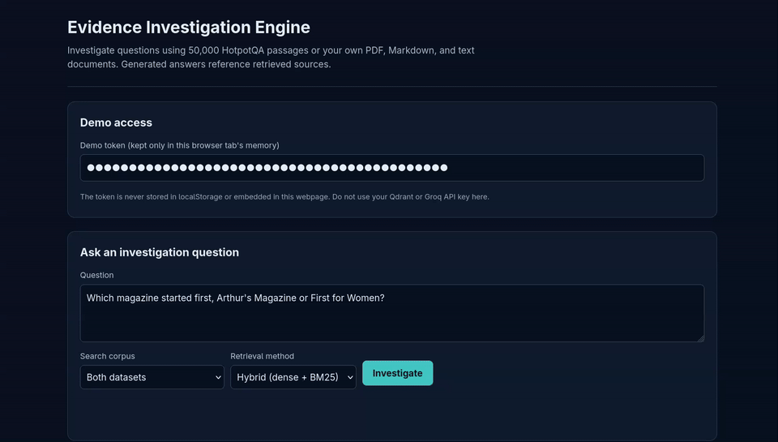
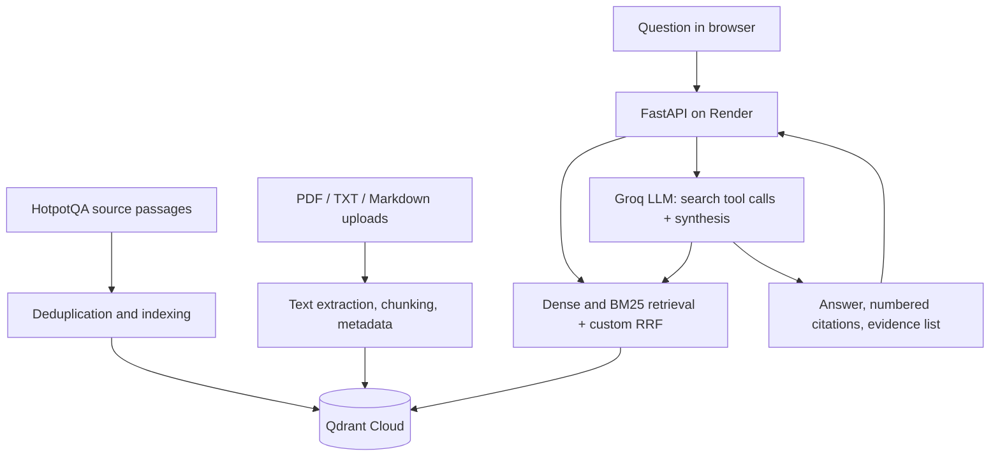
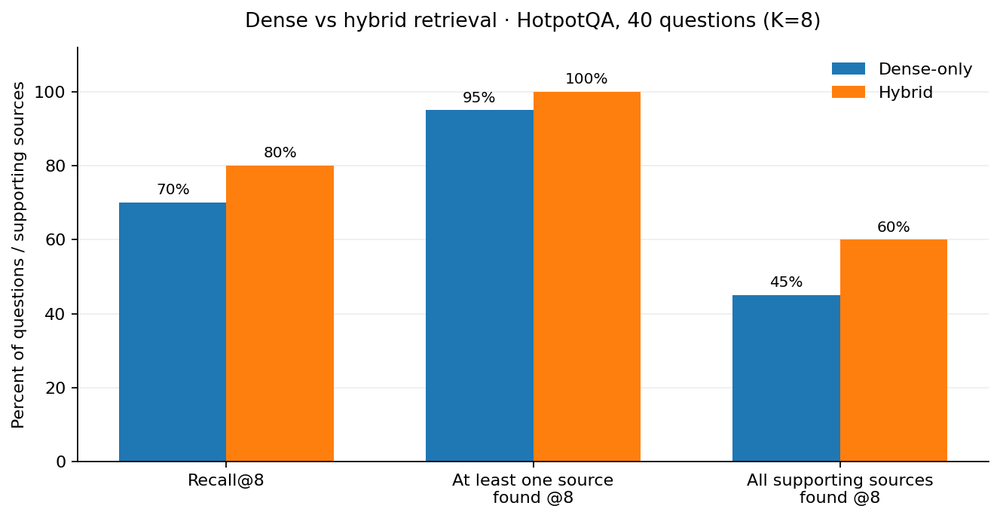

# Evidence Investigation Engine

A small investigation-oriented RAG application for searching and comparing evidence across documents. It was built for the Applied AI take-home challenge. Rather than answering from a single uploaded PDF, the application can search multiple documents, combine relevant facts, and return an answer with references to the source passages it used.

**[Live application](https://evidence-rag-9zrj.onrender.com/)** · [Evaluation report](reports/evaluation_report.md) · [AI usage disclosure](AI-USAGE.md)

The public demo requires an access token, which is shared separately with reviewers. It does **not** require users to create a Groq or Qdrant account. Both services are accessed through the backend; their API keys are never sent to the browser.

## Features

- Search a corpus of **at least 50,000 deduplicated HotpotQA source passages**, or search user-uploaded documents.
- Upload, list, replace, and delete `.pdf`, `.txt`, and `.md` documents. Text and metadata are retained in Qdrant; the original uploaded file bytes are not stored.
- Choose between fixed-size overlapping chunks and paragraph-aware chunks for uploaded documents.
- Use dense semantic search, or hybrid search combining MiniLM embeddings and BM25 keyword retrieval.
- Combine ranked dense and BM25 candidates using a **custom Python weighted reciprocal-rank fusion (RRF)** implementation, with controls to limit repeated titles.
- Perform multiple evidence searches using Groq's structured `search_evidence` tool calls, then write an answer with numbered source references.
- Attempt to acknowledge conflicting sources and insufficient evidence instead of inventing missing facts. These behaviors are tested, but not guaranteed.

## Example

**Question:** Which magazine was started first, Arthur's Magazine or First for Women?

The system retrieves the passages for *Arthur's Magazine* (published from 1844) and *First for Women* (started in 1989), then identifies Arthur's Magazine as the earlier publication. The answer references both retrieved sources.

For a second demo, upload a short Markdown incident report, choose **Uploaded documents** as the search scope, and ask a question about its contents. The same interface supports replacing or deleting that document.

## Demo



## Architecture



The main components are:

| Component | Responsibility |
|---|---|
| `scripts/prepare_hotpot.py` | Stream HotpotQA, extract source passages, deduplicate, and save evaluation questions separately |
| `scripts/ingest_hotpot.py` | Batch-upload source records to Qdrant; resume interrupted uploads |
| `src/documents.py`, `src/chunking.py` | Text extraction, document metadata, two chunking strategies, duplicate detection, and CRUD |
| `src/retrieval.py` | Dense/BM25 retrieval and custom weighted RRF |
| `src/search_multi.py` | Retrieve from HotpotQA, uploaded files, or both (combined scopes use a simple round-robin heuristic) |
| `src/investigation.py`, `src/citations.py` | Structured search-tool calls, evidence-based synthesis, error recovery, and citation normalization |
| `app_investigation.py`, `static/index.html` | FastAPI endpoints and browser interface |

**Storage:** The main source collection is `hotpot_evidence_v1`. Uploaded chunks are stored separately in `user_documents_v1`, with document metadata in `user_document_registry_v1`. Qdrant persists data independently of the Render web server, including across service restarts.

## Evaluation

I evaluated retrieval and generated answers separately. The 40 retrieval questions were drawn from HotpotQA validation examples; their expected answers and supporting-source labels were not indexed as evidence, but the relevant source passages were included in the searchable corpus.

| Metric (40 questions, K=8) | Dense | Hybrid |
|---|---:|---:|
| Supporting-source Recall@8 | 70% | **80%** |
| At least one required source found | 95% | **100%** |
| All required sources found | 45% | **60%** |
| MRR@8 | **0.8604** | 0.8592 |



In a separate 40-question answer run, 27 answers contained the expected answer literally (67.5%) and 39 used valid numbered source references (97.5%). These are **proxy measurements**, not verified semantic accuracy or claim-level citation correctness. Eight controlled synthetic-evidence tests passed their heuristic checks for missing (4/4) and contradictory (4/4) information. Those tests did not evaluate end-to-end Qdrant retrieval.

The two chunking approaches were compared on 300 documents: both produced 328 chunks. Fixed windows stored approximately 3% repeated text due to overlap, whereas paragraph-aware chunking produced no repeated text in that sample. This is **not** a demonstrated difference in search quality.

See the [full evaluation report](reports/evaluation_report.md) for methodology, raw result links, failure analysis, and limitations.

## Running locally

The deployed service uses Render for FastAPI, Qdrant Cloud for indexed data and cloud embeddings, and Groq for LLM inference. To reproduce locally, create your own Qdrant and Groq credentials. A reviewer using the live demo only needs the separately supplied demo token.

Python 3.12 is used on Render. From the repository root:

```bash
python -m venv .venv
source .venv/bin/activate
pip install -r requirements.txt
cp .env.example .env
```

Edit `.env` with your own credentials:

```dotenv
QDRANT_URL=https://YOUR-QDRANT-CLUSTER
QDRANT_API_KEY=YOUR-QDRANT-KEY
GROQ_API_KEY=YOUR-GROQ-KEY
DEMO_TOKEN=CHOOSE-A-PRIVATE-ACCESS-TOKEN
GROQ_MODEL=openai/gpt-oss-120b
```

**Never commit `.env` or working access tokens.** Ensure `requirements.txt` includes FastAPI, Uvicorn, Qdrant client, Groq client, python-dotenv, python-multipart, pypdf and the `datasets` package used by ingestion.

Run the application:

```bash
uvicorn app_investigation:app --host 127.0.0.1 --port 8000
```

Open `http://127.0.0.1:8000` and enter `DEMO_TOKEN` in the interface. The app expects a previously prepared Qdrant corpus; to build it in a new Qdrant cluster, follow the next section.

### Preparing a fresh corpus

```bash
python -m scripts.prepare_hotpot --target-records 50000 --eval-questions 60
python -u -m scripts.ingest_hotpot
```

The first command streams HotpotQA source passages and writes deduplicated records to `data/processed/`. The second uploads their dense and sparse representations to Qdrant. Uploads are resumable and use stable point IDs. The dataset can take substantial time to index, and completion depends on available cloud inference and storage quota. The large generated corpus is intentionally excluded from Git; its generation scripts and smaller evaluation artifacts are retained.

### API

All `/api/*` routes require `Authorization: Bearer <DEMO_TOKEN>`.

| Method | Path | Description |
|---|---|---|
| `GET` | `/` | Browser interface |
| `GET` | `/health` | Qdrant health and corpus information |
| `POST` | `/api/ask` | Ask a question with `scope=hotpot`, `uploaded`, or `both`; `mode=dense` or `hybrid` |
| `GET` | `/api/documents` | List uploaded documents |
| `GET` | `/api/documents/{document_id}` | Retrieve document metadata |
| `POST` | `/api/documents` | Upload a document, choosing `fixed` or `paragraph` chunking |
| `PUT` | `/api/documents/{document_id}` | Replace a document |
| `DELETE` | `/api/documents/{document_id}` | Delete a document and its chunks |

Example investigation request using environment variables for local testing:

```bash
curl -X POST http://127.0.0.1:8000/api/ask \
  -H "Authorization: Bearer $DEMO_TOKEN" \
  -H "Content-Type: application/json" \
  --data-binary @- <<'JSON'
{"question":"Which magazine was started first, Arthur's Magazine or First for Women?","scope":"hotpot","mode":"hybrid","rounds":2}
JSON
```

If you use `curl` this way, export `DEMO_TOKEN` in your shell first; the `.env` file is read by the Python app, not automatically by the shell.

### Tests and reproduction

```bash
python -m pytest -q
python -u -m scripts.smoke_documents
python -u -m scripts.evaluate_retrieval --limit 40 --k 8
python -m scripts.compare_chunking --max-docs 300
python -u -m scripts.evaluate_answers --limit 40 --max-new 5 --cooldown 2
```

The cloud smoke test creates and deletes temporary document records; the answer evaluation makes LLM calls and is resumable. Other evaluation commands and their saved outputs are documented in [`reports/evaluation_report.md`](reports/evaluation_report.md).

## Deployment and limitations

The Render start command is:

```bash
uvicorn app_investigation:app --host 0.0.0.0 --port ${PORT:-8000}
```

`QDRANT_URL`, `QDRANT_API_KEY`, `GROQ_API_KEY` and `DEMO_TOKEN` are configured as server-side environment variables. Render free instances can take time to wake up, while Qdrant Cloud and Groq free tiers have resource/rate limits. Reviewers receive the demo token privately; anyone with the token can use protected document-management operations, so it should be rotated after review.

Known limitations:

- Uploaded files must be text-extractable. Scanned/image-only PDFs are not supported because no OCR is implemented.
- Upload size is capped at 5 MB, with additional text and chunk limits.
- The citation parser verifies reference-number format and existence, **not** whether each cited passage logically supports the answer.
- The benchmark is small and centered on HotpotQA rather than real organizational incident documents.
- Exact-text deduplication does not detect paraphrased duplicates.
- Updating a document involves multiple Qdrant operations; it is not a cross-collection transaction, and concurrent updates to one document are not guaranteed safe.
- Hybrid retrieval improves evidence coverage in the tested sample, but it still missed at least one supporting source for 16 of 40 questions at K=8.
- When searching both collections, results are combined using round-robin mixing rather than a globally calibrated relevance ranking. Consequently, unrelated passages may appear among the retrieved candidates, even when the final answer cites only relevant evidence.

## Data and development disclosure

Data: [HotpotQA on Hugging Face](https://huggingface.co/datasets/hotpotqa/hotpot_qa). The application uses Qdrant Cloud and the Groq-hosted `openai/gpt-oss-120b` model.

ChatGPT was used extensively for implementation, debugging and documentation, as described in [AI-USAGE.md](AI-USAGE.md). The project was tested locally and through the public Render deployment; the [evaluation report](reports/evaluation_report.md) keeps measured results separate from unverified assumptions.
